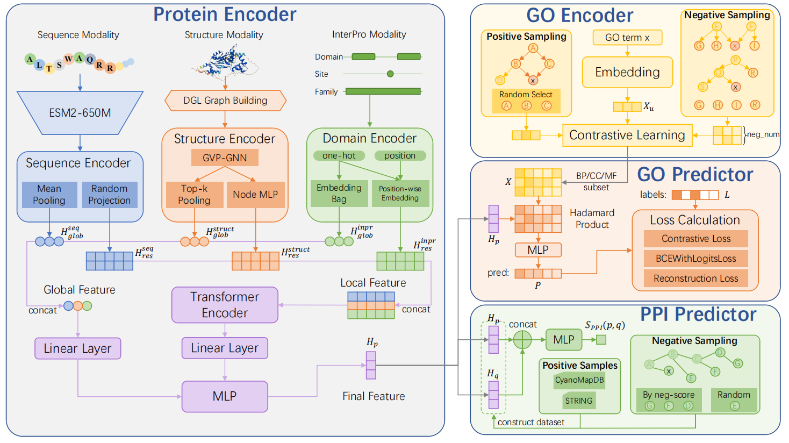
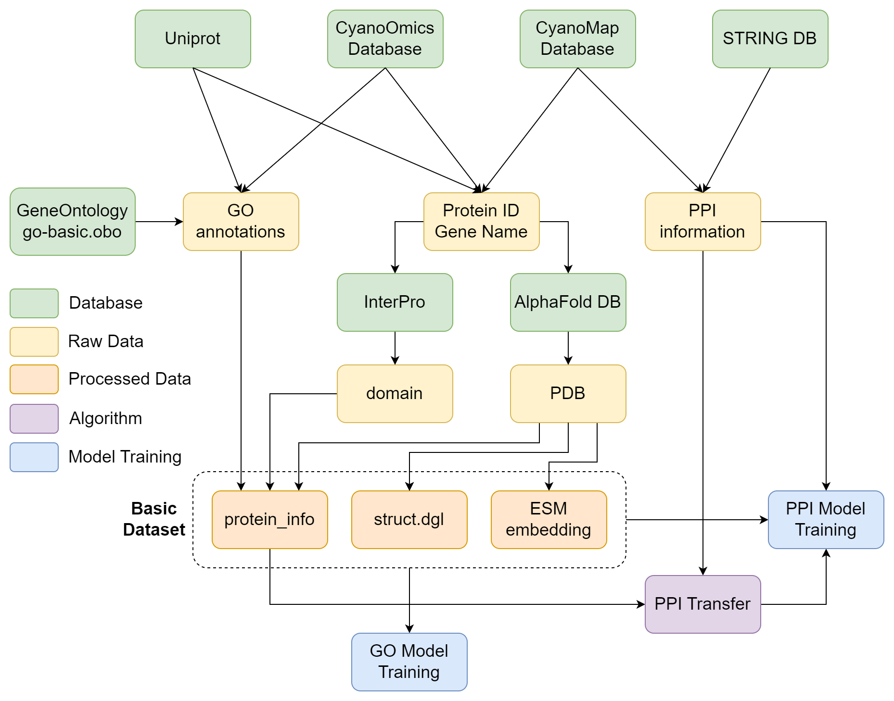

# ProtGEM

**Protein General Encoder with Multimodal Fusion**

Code for **From Ontology-Aware Protein Prediction to Biological Insight: Decoding Cyanobacterial Heterocyst Formation through Multimodal GO Annotation and PPI Inference**.

ProtGEM integrates protein sequence, three-dimensional structure, and InterPro annotations to learn protein representations for Gene Ontology (GO) annotation and protein–protein interaction (PPI) inference. The framework connects protein function prediction with the investigation of cyanobacterial heterocyst formation.

<p align="center">
  
</p>

## 📖 Overview

- **Three complementary modalities:** ESM-2 sequence embeddings, GVP-based structural features, and InterPro domain, family, and site annotations.
- **Global and residue-level fusion:** modality-specific encoders provide global and local features, with a Transformer combining the local representations.
- **Ontology-aware annotation:** protein representations are combined with GO embeddings to predict biological process (BP), cellular component (CC), and molecular function (MF) annotations. The code also supports GO embedding pretraining.
- **PPI inference and transfer:** the protein encoder supports pairwise interaction prediction and a workflow for transferring interaction evidence between datasets.

The final structural encoder uses **3 GVP convolution blocks** (`model_args.StructEncoder.num_layers = 3`). Reconstruction and auxiliary GO losses are optional components; their presence in the diagram does not mean they are enabled in every experiment. Use the configuration saved with each checkpoint to reproduce its evaluation.

## 🛠️ Installation

Use Linux and an NVIDIA GPU for the training and feature-extraction commands below. The project environment uses Python 3.11.7, PyTorch 2.2.1 with CUDA 12.1, and DGL 2.4.0 with CUDA 12.1.

```bash
git clone https://github.com/C20180602/dag-classify.git ProtGEM
cd ProtGEM

conda create -n protgem python=3.11.7 -y
conda activate protgem

python -m pip install numpy==1.26.3
python -m pip install torch==2.2.1 torchvision==0.17.1 \
  --index-url https://download.pytorch.org/whl/cu121
python -m pip install torchdata==0.7.1
python -m pip install dgl==2.4.0+cu121 \
  -f https://data.dgl.ai/wheels/torch-2.2/cu121/repo.html
python -m pip install torch-cluster==1.6.3+pt22cu121 \
  -f https://data.pyg.org/whl/torch-2.2.1+cu121.html

python -m pip install \
  transformers==4.46.3 biopython==1.84 fair-esm==2.0.0 \
  h5py==3.12.1 torchinfo==1.8.0 mlflow==3.7.0 \
  pandas==2.2.2 scipy==1.14.1 scikit-learn==1.8.0 networkx==3.2.1 \
  click==8.1.7 tqdm==4.66.5 requests==2.32.3 \
  matplotlib==3.9.2 pyyaml==6.0.2 pydantic==2.8.2

python -m pip check
python -c "import torch, dgl, torch_cluster; print(torch.__version__, dgl.__version__); print('CUDA available:', torch.cuda.is_available())"
```

The binary packages must match the PyTorch/CUDA combination. See the [PyTorch installation commands](https://pytorch.org/get-started/previous-versions/), [DGL wheel index](https://data.dgl.ai/wheels/torch-2.2/cu121/repo.html), and [PyG extension wheel index](https://data.pyg.org/whl/torch-2.2.1+cu121.html).

Optional dependencies:

```bash
# Embedding visualization
python -m pip install umap-learn==0.5.11

# Web inference interface
python -m pip install xmltramp2==3.1.1 gradio==5.29.0 gradio_molecule3d==0.0.7
```

The PPI evidence-transfer script additionally requires BLAST+ (`makeblastdb` and `blastp`) on `PATH`. Protein downloading requires `wget`.

### Experiment tracking

Training and evaluation use MLflow. For a local tracking server, run this in a separate terminal:

```bash
conda activate protgem
mlflow server --host 127.0.0.1 --port 8080
```

In the terminal used for experiments:

```bash
export MLFLOW_TRACKING_URI=http://127.0.0.1:8080
```

## 📦 Data and checkpoints

| Dataset identifier | Role |
| --- | --- |
| `AF2DB` | Main GO annotation training and evaluation dataset, CAFA-58k |
| `7120` | Cyanobacterial GO annotation, PPI prediction, and biological analysis |
| `29413` | Source dataset for transferring PPI evidence to `7120` |

**Data release:**

Model Checkpoints: [](https://doi.org/10.5281/zenodo.23560400)

Raw data: [](https://doi.org/10.5281/zenodo.23620288)

Large datasets, computed features, and trained weights are not bundled with a Git clone. The final AF2DB experiment is `workspace/AF2DB/no_l2/`. The planned release includes the raw `7120` and `29413` datasets; PPI evidence transfer does not require a `29413` model checkpoint.

Keep **weights, configuration, label lists, cached sample order, and split indices together**. The `cache/` directory contains experiment-defining information, not just disposable intermediates. Some legacy caches contain absolute feature paths; relocate those paths to the local checkout while preserving sample order and label mappings.

```text
ProtGEM/
├── asset/                        # Model and data-processing figures
├── config/                       # Defaults for new experiments
├── raw_data/
│   ├── go-basic.obo
│   ├── interpro_entry.txt
│   ├── interpro2go.txt
│   ├── swissprot_go.tsv          # GO pretraining source annotations
│   └── <DATASET>/
│       ├── pid_list.json
│       ├── pdb/                  # Protein structures
│       ├── domain/               # Per-protein InterPro TSV files
│       ├── go/                   # pgo_dict.json or go.tsv
│       └── ppi/                  # Positive interaction pairs
├── processed_data/               # Protein records and GO/InterPro mappings
├── dataset/
│   ├── go_graph_nx.pkl
│   ├── go_graph_dgl.pkl
│   ├── go_term_dis.json
│   └── <DATASET>/<PROTEIN_ID>/
│       ├── seq_emb.pkl
│       └── struct_gvp.dgl
├── model_params/                 # Optional GO pretraining checkpoints
└── workspace/<DATASET>/<EXPERIMENT>/
    ├── config/
    ├── cache/
    ├── idx/
    ├── log/
    └── model_param/
```

## 🚀 Quick start: evaluate the final GO model

After obtaining the AF2DB experiment bundle, matching processed data, GO graph files, and protein features, run from the repository root:

```bash
for ont in bp cc mf; do
  CUDA_VISIBLE_DEVICES=0 python test.py \
    -s AF2DB -n no_l2 -t v1.1 -o "$ont"
done
```

This loads `workspace/AF2DB/no_l2/model_param/{bp,cc,mf}_model.pt` with its saved configuration and test splits. Results go to `log/test_<ontology>.log` inside the experiment and to MLflow. `test.py` also runs feature analyses after the main evaluation, so it takes longer than a single prediction pass.

Do not start fresh training under the archived experiment name: the default training mode regenerates dataset caches and splits. Fresh training and evaluation of an archived checkpoint are separate workflows.

## 📂 Prepare data from raw inputs

<p align="center">
  
</p>

The steps below follow [the original reproduction notes](docs/Baseline.md), with commands matched to the current scripts. Run all commands from the repository root. For paper evaluation, use the original database snapshots and mappings; rebuilding from updated databases creates a different dataset.

### 1. Prepare source files

Place `go-basic.obo`, `interpro_entry.txt`, and `interpro2go.txt` in `raw_data/`. Sources: [GO ontology downloads](https://geneontology.org/docs/download-ontology/) and [InterPro downloads](https://www.ebi.ac.uk/interpro/download/).

Create a dataset directory, replacing `AF2DB` with `7120`, `29413`, or your own identifier as needed:

```bash
DATASET=AF2DB
mkdir -p "raw_data/$DATASET"/{pdb,domain,go,ppi}
mkdir -p processed_data dataset model_params logs
```

For downloading structures and InterPro annotations, prepare `raw_data/<DATASET>/pid_list.json` as an array of UniProt accessions:

```json
["P12345", "Q12345"]
```

```bash
python data_process_scripts/alphafold_pdb_downloader.py -s "$DATASET"
python data_process_scripts/interpro_domain_downloader.py -s "$DATASET"
```

These downloaders retrieve the source versions configured in the scripts. Use archived structures and annotations when reproducing the paper.

For GO labels, the preferred input is `raw_data/<DATASET>/go/pgo_dict.json`:

```json
{
  "P12345": ["GO:0008150", "GO:0003674"],
  "Q12345": ["GO:0005575"]
}
```

Alternatively, provide `go/go.tsv` with a header, accession in the **first column**, and GO IDs separated by `; ` in the **third column**. If both exist, `pgo_dict.json` takes precedence. `raw_data/swissprot_go.tsv` uses the same first/third-column convention.

For PPI experiments, supply **positive pairs only** in `raw_data/<DATASET>/ppi/ppi_list.json`:

```json
[["P12345", "Q12345"], ["P12345", "Q67890"]]
```

Negative pairs are constructed by the dataset loader. Keep the resulting pair caches and split indices for a specific evaluation.

### 2. Build shared annotations and GO graphs

```bash
python data_process_scripts/process_go_basic.py
python data_process_scripts/process_interpro.py
python data_process_scripts/build_go_graph.py
```

These produce GO/InterPro mappings in `processed_data/`, the two GO graphs, and `dataset/go_term_dis.json`. Graph construction does not require BioBERT embeddings. For a different ontology or InterPro snapshot, update the model vocabulary sizes to match the generated mappings.

### 3. Build protein records and features

```bash
python data_process_scripts/process_protein_new.py -s "$DATASET" -ml 2048
CUDA_VISIBLE_DEVICES=0 python pretrain/seq_esm_new.py -s "$DATASET"
CUDA_VISIBLE_DEVICES=0 python data_process_scripts/build_pdb_graph_new.py -s "$DATASET"
```

Outputs are `processed_data/<DATASET>_protein_info.json`, the corresponding coordinate file, and per-protein `seq_emb.pkl` / `struct_gvp.dgl` files. Sequence features use **ESM-2 `esm2_t33_650M_UR50D`, layer 33**. Protein records and sequence extraction filter out proteins longer than 2,048 residues. Structure graphs require backbone atoms from the PDB files; the coordinate cache alone cannot rebuild them.

Repeat this stage for `7120` and `29413` for downstream analysis. Compatible archived features can be restored instead of recomputed.

## 🧬 Train and evaluate GO annotation

For a new experiment, review `config/ProteinEncoder.conf`, `config/GoEncoder.conf`, `config/Predictor.conf`, and `config/train.conf`. The GO CLI identifier for ProtGEM is **`v1.1`**; `-n` selects the experiment name.

The first run copies defaults into `workspace/<DATASET>/<EXPERIMENT>/config/`. Subsequent runs use those local copies. To match a paper experiment, use its saved configuration rather than assuming current defaults are identical.

```bash
# New experiment; keep the archived no_l2 experiment separate.
for ont in bp cc mf; do
  CUDA_VISIBLE_DEVICES=0 python train.py \
    -s AF2DB -n protgem_run -t v1.1 -o "$ont"
done

for ont in bp cc mf; do
  CUDA_VISIBLE_DEVICES=0 python test.py \
    -s AF2DB -n protgem_run -t v1.1 -o "$ont"
done
```

`train.py` currently constructs the GO sampling dataset even when auxiliary GO loss is disabled. Supply `raw_data/swissprot_go.tsv` or compatible GO sampling caches alongside the shared GO graphs.

| Training option | Meaning |
| --- | --- |
| `-o bp`, `-o cc`, `-o mf` | Select GO namespace |
| `-preg model_params/go_pretrain_model.pth` | Initialize the GO encoder from pretrained weights |
| `-c True` | Load weights and reuse cached GO data/splits; optimizer and scheduler state restart |
| `--max-grad-norm 1.0` | Global gradient clipping threshold; default `1.0` unless configured otherwise |
| `--detect-anomaly` | Slower backward diagnostics |

Current training includes numerical checks and clipping added after the historical experiments. New runs are not guaranteed to reproduce historical weights exactly. The final depth is three GVP blocks; 15-block experiments are exploratory.

### Optional GO embedding pretraining

Prepare shared GO files and `swissprot_go.tsv`, then run:

```bash
CUDA_VISIBLE_DEVICES=0 python train_go_emb.py
```

This reads `config/train_go.conf` and `config/GoEncoder.conf`, asks whether to initialize with BioBERT embeddings, and saves **`model_params/go_pretrain_model.pth`**. Answer `n` for random initialization. For BioBERT, first generate `dataset/go_embedding_biobert.pkl` using [the BioBERT instructions](pretrain/biobert/readme.md), which use the 1,024-dimensional `dmis-lab/biobert-large-cased-v1.1` model. Match the initialization and checkpoint to the intended experiment.

### Annotate the cyanobacterial target dataset

After preparing `7120` protein records and features, apply the AF2DB model:

```bash
for ont in bp cc mf; do
  CUDA_VISIBLE_DEVICES=0 python batch_inference_go.py \
    -s AF2DB -n no_l2 -t v1.1 -o "$ont" -ds 7120
done
```

## 🔗 PPI training, evaluation, and transfer

PPI uses CLI identifier **`ppi_v1`** and `config/ProteinEncoder.conf`, `config/Predictor_ppi.conf`, and `config/train_ppi.conf`. These commands create a new example experiment; paper-specific evaluation requires the corresponding saved experiment and pair caches.

```bash
CUDA_VISIBLE_DEVICES=0 python train_ppi.py \
  -s 7120 -n protgem_ppi -t ppi_v1 -pfn ppi_list.json

# Load saved weights AND reuse the cached test split.
CUDA_VISIBLE_DEVICES=0 python train_ppi.py \
  -s 7120 -n protgem_ppi -t ppi_v1 -pfn ppi_list.json \
  -c True -test True
```

Pass `-th <validation_threshold>` during testing to use a threshold selected on validation data. Without it, the test routine reports Fmax by sweeping test scores. The separate test command reloads the saved best checkpoint; evaluation at the end of a fresh training run uses its last in-memory weights.

For transfer learning, `-prep` expects a **protein-encoder-only state dictionary**, not a complete BP/CC/MF checkpoint. Its architecture must match the source encoder. Use the corresponding exported encoder and saved PPI configuration.

To transfer interaction evidence from `29413` to `7120`, prepare both datasets' protein records and `ppi/ppi_list.json`, install BLAST+, and run:

```bash
python gen_ppi_transfer.py -s 29413 -d 7120

CUDA_VISIBLE_DEVICES=0 python train_ppi.py \
  -s 7120 -n protgem_ppi_transfer -t ppi_v1 \
  -pfn transferred_ppi_list.json

CUDA_VISIBLE_DEVICES=0 python train_ppi.py \
  -s 7120 -n protgem_ppi_transfer -t ppi_v1 \
  -pfn transferred_ppi_list.json -c True -test True
```

The transfer script uses sequence matching and source interaction pairs, and writes `raw_data/7120/ppi/transferred_ppi_list.json`. It does not load a `29413` model. Retain the selected PPI source file, pair caches, and splits with each experiment.

For all-pairs inference using a trained PPI experiment:

```bash
CUDA_VISIBLE_DEVICES=0 python batch_inference_ppi.py \
  -s 7120 -n protgem_ppi -t ppi_v1
```

## 🗂️ Repository guide

| Path | Contents |
| --- | --- |
| `model/` | Encoders, predictors, datasets, and losses |
| `data_process_scripts/` | Downloads, annotation processing, and graph construction |
| `pretrain/` | ESM-2 features and BioBERT initialization |
| `train.py` / `test.py` | GO training and evaluation |
| `train_ppi.py` | PPI training and evaluation |
| `batch_inference_go.py` / `batch_inference_ppi.py` | Dataset-wide prediction |
| `gen_ppi_transfer.py` | Sequence-based transfer of PPI evidence |
| `draw_scripts/` | Experimental plots and analysis figures |
| `docs/Baseline.md` | Original reproduction notes in Chinese |
| `docs/agent/` | Agent-authored development records |

Run regression tests with:

```bash
python -m unittest discover -s tests -v
```

## 📝 Citation

If you use ProtGEM, please cite **From Ontology-Aware Protein Prediction to Biological Insight: Decoding Cyanobacterial Heterocyst Formation through Multimodal GO Annotation and PPI Inference**. Publication metadata and BibTeX will be added when available.

## 📜 License

This repository includes the [GNU General Public License v3.0](LICENSE).
