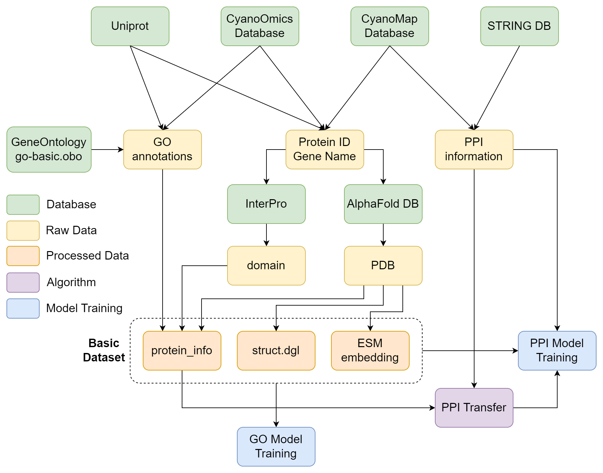

# 复现流程
## Pipeline

## 数据下载以及准备流程
- 在GeneOntology [https://geneontology.org/docs/download-ontology/]数据库上下载go-basic.obo，取得GO标签的基础信息与关系。保存至raw_data文件夹下。

- 在InterPro [https://www.ebi.ac.uk/interpro/download/]数据库上下载InterPro entry list和InterPro-GO mapping，获取InterPro标签的基础信息。保存至raw_data文件夹下。

- 在raw_data下建立物种文件夹SPECIES_NAME，并在下方建立四个子文件夹domain, go, pdb, ppi

- 在物种文件夹下，新建pid_list.json，内容格式为：(Uniprot ID 1表示蛋白质的Uniprot数据库编号)
``` json
[
    "Uniprot ID 1",
    "Uniprot ID 2",
    "Uniprot ID 3",
    ...
]
```

### pdb数据准备
- 使用alphafold_pdb_downloader.py读取pid列表下载PDB文件，使用 -s参数传递物种名称。

### InterPro（domain）数据准备
- interpro_domain_downloader.py通过pid列表下载interpro文件（可同时进行）

### GO标签数据准备（TODO：自动化GO标签获取）
- 根据pid列表，使用uniprot的id_mapping功能，完成映射后，下载tsv文件，里面勾选只勾选GO标签编号，将下载的tsv文件命名为go.tsv，放置在raw_data/SPECIES_NAME/go文件夹下。

- 如果你有已经整理好的数据，可以直接使用json导入，文件名为pgo_dict.json，json格式为如下，位置也放置在raw_data/SPECIES_NAME/go文件夹下即可。
``` json
{
    "Uniprot ID": [
        "GO:XXXXXXX",
        "GO:XXXXXXX",
        "GO:XXXXXXX",
        ...
    ],
    "Uniprot ID": [
        "GO:XXXXXXX"
    ],
    ...
}
```
- 注意：若使用第二种方式读取数据，会自动忽略第一种格式的数据。

### PPI数据准备
- 为了避免数据处理逻辑过于复杂，建议在外部处理好数据再转为json格式导入，json文件名为ppi_list.json，放置在raw_data/SPECIES_NAME/ppi文件夹下，格式如下：

- 注意：文件中只保留ppi的正样本数据。
``` json
[
    [
        "PPI1-Uniprot ID 1",
        "PPI1-Uniprot ID 2"
    ],
    [
        "PPI2-Uniprot ID 1",
        "PPI2-Uniprot ID 2"
    ],
    ...
]
```


## 数据处理
1、运行data_process_scripts下的process_go_basic.py、process_interpro.py、process_protein_new.py

2、运行pretrain/seq_esm_new.py和data_process_scripts/build_pdb_graph_new.py，顺序可任意
## 模型训练
### GO模型训练与测试
1、运行train_go_emb.py，预训练go的初始嵌入，得到go_pretrain_model模型，保存在model_params文件夹中

2、运行train.py，训练protein_model模型和go_model模型，输出内容在workspace_{species_name}_{model_name}中

可选参数 -preg model_params/go_pretrain_model_1024.pth，使用预训练的go初始嵌入
```
CUDA_VISIBLE_DEVICES=0 python train.py -o bp -s HUMAN
CUDA_VISIBLE_DEVICES=1 python train.py -o cc -s HUMAN
CUDA_VISIBLE_DEVICES=2 python train.py -o mf -s HUMAN
```
3、运行test.py，得到测试集结果。
```
CUDA_VISIBLE_DEVICES=0 python test.py -o bp -s HUMAN
CUDA_VISIBLE_DEVICES=1 python test.py -o cc -s HUMAN
CUDA_VISIBLE_DEVICES=2 python test.py -o mf -s HUMAN
```

4、消融实验

通过 -t seq_abl 传入消融的模型类型（seq_abl表示只有序列特征，其他同理）

重新训练模型并测试

5、迁移测试、模型微调、批量预测

具体方法见journal.md

6、本地GO预测网页

启动inference.py即可

### PPI模型训练与测试

#### PPI训练
- 可以不添加-prep参数
'''
python train_ppi.py -s xxx -prep workspace/Pretrain_dataset/xxx_model/model_param/all_pm_model.pt
'''

#### PPI预测
- 运行data_export_scripts/export_pm_model.py，导出任意一个模型的protein model部分
```
python data_export_scripts/export_pm_model.py -o all -s AF2DB -n model_v1.1_back -t v1.1
```
- 运行train_ppi.py，可选择以刚才导出的protein model模型为基础进行训练+测试
```
python train_ppi.py -s TARGET_DATASET -prep workspace/AF2DB/model_v1.1/model_param/all_pm_model.pt
```

#### - PPI迁移学习
- 在目标物种D上出现PPI较少，孤立点较多的情况，建议采用gen_ppi_transfer.py丰富PPI
- 将物种A的PPI通过blast比对，将高相似的ppi转移到B上
```
python gen_ppi_transfer.py -s A_species -d B_species
```
- 使用train_ppi.py训练时添加 -trs True选项，使用转移后的ppi数据进行训练


### GO、PPI批量预测
- python batch_inference_go.py -o bp -s AF2DB -n model_v1.1 -t v1.1 -thresh 0.75 -ds TARGET_DATASET
- python batch_inference_ppi.py -s DATASET -n model_ppi_v1 -t ppi_v1 -thresh 0.9

### GO训练磁盘空间节省模式
- 使用ESM在线推理获取ESM embedding，但训练时间会更长，显存占用更高
- 由于PPI训练规模远大于GO训练，最好还是提前预处理ESM嵌入，故不支持磁盘节省模式。
- 使用"-li True"参数开启该模式
```
CUDA_VISIBLE_DEVICES=0 python train.py -o bp -t v1.1 -n model_v1.1 -s 7120 -li True
```